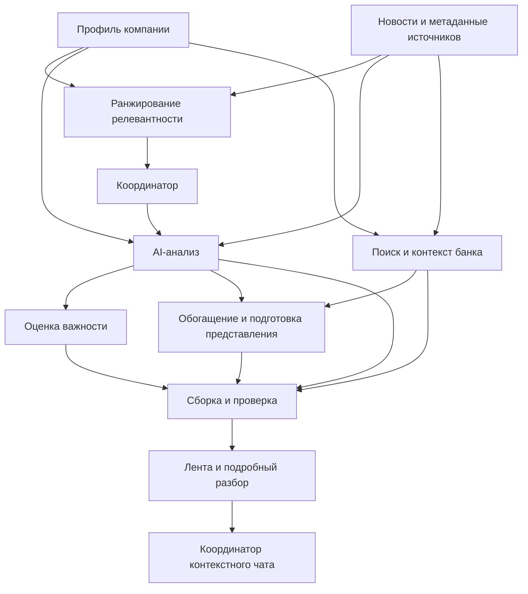

# T01: границы компонентов и совместимость контрактов

Статус: черновик для согласования командой. Ветка создана от `dev`. DoD: предложены JSON-контракты CompanyProfile, NewsEvent и Insight, определены входы, выходы и зависимости модулей. Формальное согласование командой не подменяется проверкой примеров.

Основной принцип: **AI-модуль не обязан возвращать все поля UX**. Объект для интерфейса собирается из результатов анализа, классификатора важности, поиска банковских материалов, обогащения и подготовки представления. Отсутствие реализации одного из этих модулей не является противоречием контрактов.

## 1. Какие объекты передаем

| Граница | Формат | Источник истины |
|---|---|---|
| Данные -> ранжирование/AI | [CompanyProfile](ai-company-profile.schema.json), [NewsEvent](ai-news-event.schema.json) | Без изменений экспортированы из `research/ai/contracts.py` |
| Агент -> анализатор | [LLM input](llm-input.schema.json) | Текущее содержимое user payload в `provider.analyze`: источники с текстом, вопрос, история предыдущих AI-результатов, JSON Schema |
| AI -> сборка результата | [AiInsight](ai-insight.schema.json) | Без изменений: `company_id`, `news_id`, `status`, `summary`, `claims`, `missing_data`, `follow_up_answer` |
| Координатор -> агент | [AnalysisRequest](analysis-request.schema.json) | Выбранная компания, корпус событий, ID выбранной новости, момент анализа, вопрос |
| Ранжирование -> координатор | [RankingResult](ranking-result.schema.json) | Текущий `rank_pair`: score, eligible, reasons, missing_data |
| Классификатор -> сборка | [ImpactAssessment](impact-assessment.schema.json) | Важность high/medium/low, причина и основания; отдельно от score релевантности |
| Поиск/RAG банка -> сборка | [BankContext](bank-context.schema.json) | Источники, даты, периоды прогноза, позиция банка и отдельно ее интерпретация |
| Модуль дополнительных блоков -> сборка | [UxEnrichment](ux-enrichment.schema.json) | Последствия, риски, возможности, горизонт, расчет, проверки, быстрые вопросы |
| Все результаты -> сборка | [AssemblyRequest](assembly-request.schema.json) | AI-объекты + метаданные + подготовленные тексты + результаты других модулей |
| Сборка -> API/UI | [UxBundle](ux-bundle.schema.json) | Ссылки на существующие U01-схемы CompanyProfile, NewsEvent, Insight, FeedCard |
| UI -> координатор чата | [ChatRequest](chat-request.schema.json) | Версия разбора, снимок контекста, история, новое сообщение |

Имена `CompanyProfile`, `NewsEvent`, `Insight` в AI-коде и U01 раньше совпадали, но формы данных разные. Это не один взаимозаменяемый JSON. Теперь границы названы явно: `AiCompanyProfile / AiNewsEvent / AiInsight` и `UxCompanyProfile / UxNewsEvent / UxInsight`. Имена классов AI в коде **не переименованы**, здесь это обозначения в документации. Не отправлять полный UX-разбор в LLM вместо его схемы ответа.

## 2. Входы, выходы и зависимости модулей



| Модуль | Вход | Выход | Зависимости и текущая готовность |
|---|---|---|---|
| Нормализация компании | Строка датасета, словарь полей, ID | AiCompanyProfile + label, profile_version, profile_as_of | Нужна проверка CSV. Сейчас только синтетические fixtures; `SYNTHETIC_U` не теряется при назначении id |
| Нормализация новости | Сохраненная публикация и метаданные загрузки | AiNewsEvent + publisher, collected_at, is_fictional_event | Сборщик уже есть; AI-проекция выбирает нужные поля, не удаляя исходную запись |
| Ранжирование | CompanyProfile, NewsEvent, as_of | RankingResult | Реализованы правила по ОКВЭД/географии/свежести; нет подтверждения промышленного качества |
| Координатор анализа | AnalysisRequest | AiInsight + внутренний trace/checkpoint | Существующий ResearchAgent. Проверяет выбранную новость, изоляцию компании и цитаты; не является backend API |
| LLM-анализатор | LlmInput внутри вызова провайдера | AiInsight | Код клиента есть, сохраненные результаты offline. Транспорт и модель не выбираются этой задачей |
| Классификация важности | Компания, событие, доступный анализ и его основания | ImpactAssessment | Интерфейс предложен; реализация может быть правилами, отдельным классификатором или редакционной оценкой. Score ранжирования не назначает важность |
| Банковский поиск/RAG | Событие, профиль, as_of, корпус материалов банка | BankContext | Интерфейс предложен; конкретный RAG и хранилище не выбраны. Found требует реального фрагмента и даты/периода, если известны |
| Дополнительные блоки | AI-результат, компания, источники, BankContext, при наличии вычисленные показатели | UxEnrichment | Интерфейс предложен; это может быть несколько модулей, не один LLM-вызов. Расчет не извлекается из рыночного процента без оснований |
| Подготовка представления | Событие и персональная интерпретация | presentation: effect_title, event_summary, origin | Короткие тексты для мобилки. Сейчас используются явно отмеченные demo fixtures, а не скрытая генерация в адаптере |
| Сборка | AssemblyRequest | UxBundle | Есть проверяемый черновой адаптер; AI-пакет сохраняется без изменений |
| Финальная проверка | UxBundle, основания, результаты модулей | Решение о публикации/уточнении/перезапуске | Проверка формы/ссылок реализована; семантическая проверка и политика полноты пока не реализованы. Адаптер честно оставляет partial |
| Координатор чата | ChatRequest, снимок контекста, новое сообщение | Сообщение по U01 chat-context + обновленная история | Интерфейс предложен. Текущий provider принимает предыдущие AiInsight, а не произвольные UI messages. Нужен слой сборки запроса, не передача UX-истории как есть |

Контекст банка может подаваться отдельному анализатору/обогатителю без изменения AiInsight. Чтобы конкретный AI-вывод содержательно учитывал банк, банковские фрагменты должны войти в контекст **до** получения этого вывода. Простое добавление BankContext в карточку не доказывает, что банк повлиял на исходный AI-анализ. В текущем `provider.evidence_sources` разрешены только новость и признаки компании; подключение банковских источников туда — отдельная будущая реализация, не выполненная в T01.

## 3. Соответствие полей и правила на стыках

| Исходное поле | Поле представления | Правило |
|---|---|---|
| company.id | company_id | Тот же ID; подпись компании приходит в метаданных, не выводится из обезличенного ID |
| news.id / AiInsight.news_id | event_id | Тот же ID, без независимой перенумерации |
| company.okved_codes, okved_names и другие признаки | features | У каждого признака ID исходного поля и происхождение. Массив отображается JSON-текстом; исходный типизированный массив остается в AI-профиле |
| registration_region | feature registration_region | Это регион регистрации, не место продаж или производства |
| annual_revenue_rub | feature + unit RUB | Период неизвестен, если его нет во входе; не подставлять текущий год |
| news.title, text, url, published_at | original_title, text, source.url, published_at | Издатель и collected_at берутся из загрузчика, не угадываются по URL |
| claims.fact | source_fact | Атрибутированный факт источника, а не подтверждение любого содержания публикации |
| claims.hypothesis | ai_inference | Не превращать автоматически в риск, возможность или позицию банка |
| evidence.source_id + quote | source_id + fragment_id | Проверить точную цитату; адаптер создает фрагмент с исходным текстом и диапазоном символов |
| AiInsight.summary | conclusion.text | AI-резюме с основаниями и оговоркой о семантической проверке; это не автоматически короткий заголовок |
| status=supported | Не равен ready | Означает статус AI-анализа, не полноту собранного UX-документа |
| rank.score | Только сортировка/поиск | Не переводится порогами в high/medium/low важность |
| ImpactAssessment.importance | importance | Отдельный модуль явно указывает причину, метод и основания |
| BankContext.bank.position | bank.position | Только позиция банка с источником; интерпретация хранится отдельно |
| follow_up_answer | Текст ответа чата | Сохраняется в AiInsight, UI-координатор добавляет message_id, время, ссылки и статус; исходный адаптер не создает фиктивную переписку |

Служебные версии назначает координатор: `contract_version` относится к границе T01, `schema_version=0.1.0` — к неизмененным UX-схемам, `profile_version` и `insight_version` — к содержимому. AiInsight не знает версию профиля, поэтому координатор обязан связать ответ с исходным снимком запроса. По одному старому AI-пакету подтвердить эту версию невозможно. Результаты классификации, банка и обогащения проверяются по company_id/news_id/profile_version; ChatRequest дополнительно фиксирует insight_version.

Пропуски остаются null/пустыми списками с пояснением, не превращаются в нули или low. Если оценка важности еще не получена, координатор не создает AssemblyRequest с вымышленным значением: может показать неполный FeedCard с importance=null по существующей U01-схеме. Алгоритм окончательной готовности не выбран; это не повод расширять AI-ответ обязательными UX-полями.

Неверный ID, устаревшая версия или несуществующая цитата отклоняются, а не исправляются подстановкой другой компании/источника. При сбое модуля сохраняется его статус и доступный результат; не объявлять отсутствие результата отсутствием риска. В текущем провайдере уже есть ограниченный повтор/исправление ответа, отдельную бесконечную петлю повторов координатор не добавляет. Транспортный формат ошибок и HTTP-маршруты в T01 не фиксируются.

BankContext=null означает, что модуль не подключен/результат недоступен; это не not_found. Not_found допустим после выполненного поиска. Outdated и conflicting сохраняют даты и альтернативные позиции. Внешние материалы — данные, содержащиеся в них инструкции не меняют системный процесс.

## 4. Что изменено и что остается отдельной работой

- **AI-код и его контракты не изменены.** Экспорты проверяются на совпадение с текущими Pydantic-моделями; известные ограничения модельных валидаторов дополнительно проверяются Python-кодом.
- **U01-схемы и HTML-макет не изменены.** Новые форматы лежат в t01, существующие потребители продолжают работать. Адаптер — отдельная демонстрация границы, не подключение AI к HTML.
- Добавлены новые контракты классификации, банковского контекста, обогащения, сборки и запроса чата. Они не требуют, чтобы один модуль отвечал за все поля.
- Схемы не подтверждают качество ранжирования, истинность вывода или запуск LLM. API, СУБД, очереди, RAG и конкретная модель не выбраны.
- В `provider.py`/Compose остается ранее обнаруженный default `deepseek-v4-pro`, не входящий в разрешенный список. Здесь он не менялся и не вызывался; перед live-запуском нужно отдельно выбрать разрешенную модель и проверить провайдера.

## 5. Примеры и проверка

Примеры в [examples](examples):

- `analysis-request.json`, `ranking-result.json` — существующие offline-данные на границе агента.
- `llm-input.json` — точная форма текущего user payload провайдера; ключей и реального вызова в примере нет.
- `assembly-request.json` -> `ux-bundle-request.json` — реальный сохраненный offline AI-ответ + демо-результат классификации/подготовки текста; банк не подключен.
- `assembly-with-enrichment.json` -> `ux-bundle-with-enrichment.json` — тот же AI-ответ плюс **смоделированные** ответы независимых модулей банка и обогащения. Банковский материал вымышленный, не позиция Альфа-Банка.
- `chat-request.json` — запрос по снимку собранного разбора; не свидетельство готового API чата.

Профиль AI-demo оставлен исходным, включая выручку ниже 15 млрд: это проверка совместимости с текущими fixtures, не пример целевого клиента продукта. Времена снимков и редакционные тексты в примерах — демонстрационные метаданные, не измерения live-прогона.

```sh
# Из корня репозитория. Нужен Python 3.12+.
python -m pip install -r research/ai/requirements.txt -r research/contracts/requirements.txt
python research/contracts/t01/verify.py
python -m unittest discover -s research/contracts/t01 -p "test_bridge.py" -v
python research/contracts/validate.py
python -m unittest discover -s research/ai -p "test_research.py" -v
```

Схемы и примеры воспроизводимы: `export_schemas.py`, затем `make_examples.py`. Эти две команды перезаписывают только T01 JSON-файлы. `adapter.py input.json output.json` проверяет запрос и создает UX-bundle без сети и LLM. Проверки не требуют ключей.
